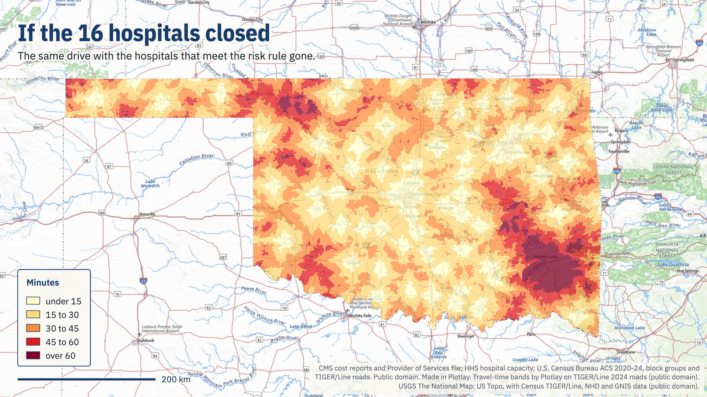
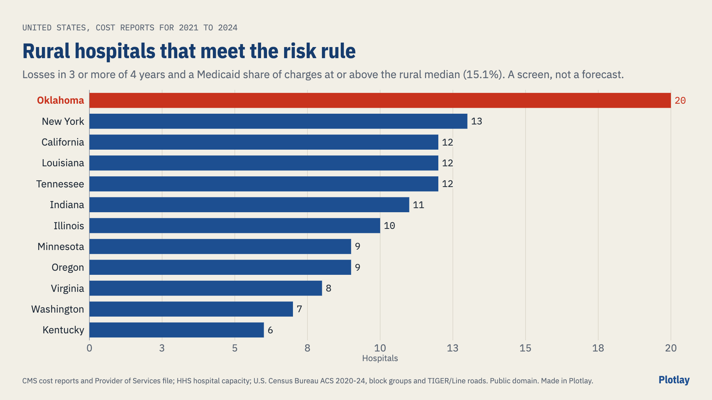
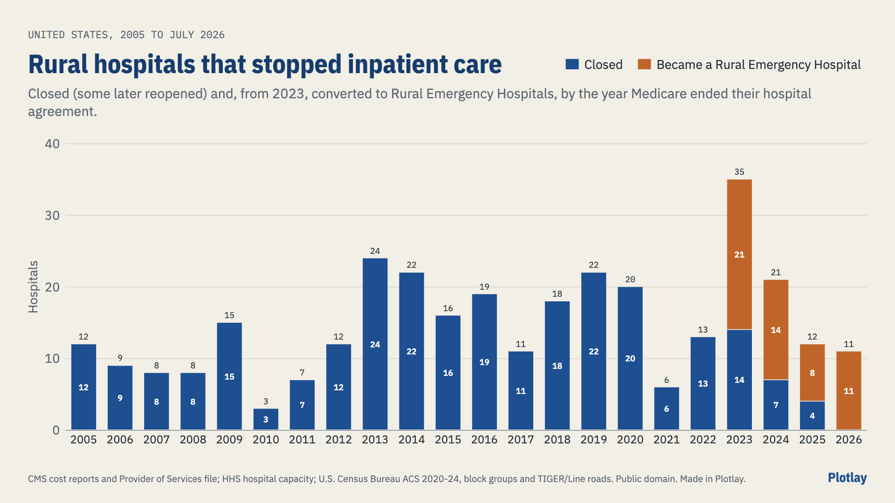
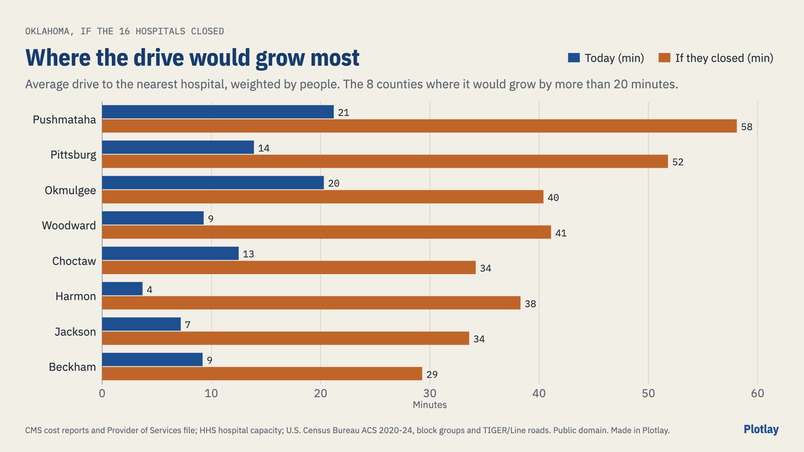
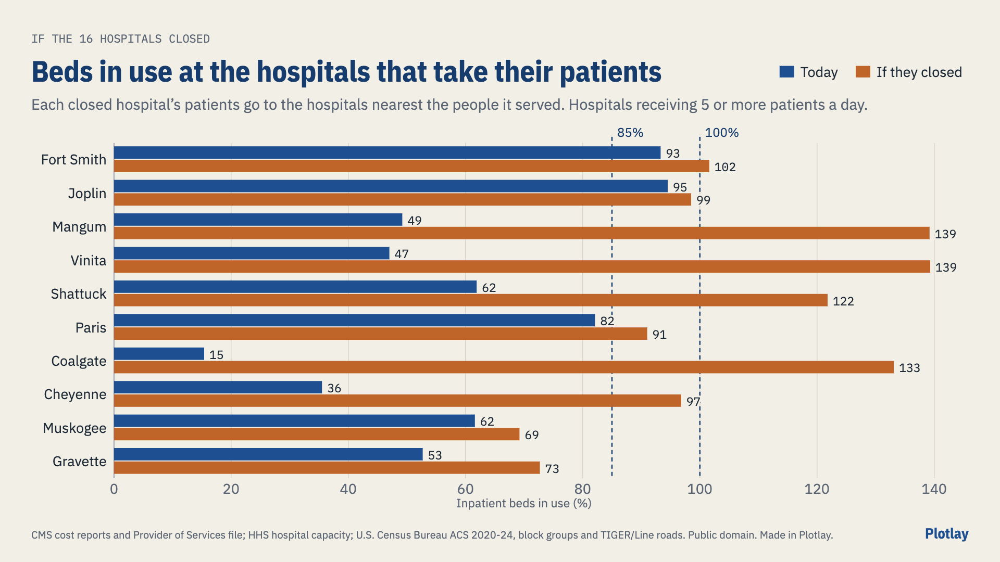

# If Oklahoma's weakest rural hospitals closed

How much longer would people drive to the nearest hospital, and how full would the hospitals that stay open get? **A scenario, not a forecast.** The rural hospitals that meet one written rule from their own Medicare cost reports are taken off the map, and everything else stays as it is. **Live version, with an interactive map:** [getplotlay.com/showcase/rural-hospitals](https://www.getplotlay.com/showcase/rural-hospitals/)

16 of Oklahoma's 74 rural hospitals meet the rule. If all of them closed, the Oklahomans living more than 30 minutes' drive from a hospital would rise from **132,970 to 348,649**, and those more than 45 minutes away from 11,902 to 91,235. 369,390 people would drive 23 minutes longer on average. Of the 34 hospitals that would take their patients, 12 would be 85% full or more, against 4 today.

[Plotlay](https://www.getplotlay.com) puts the pieces on one map: hospitals keyed by their CMS number, block groups by their GEOID with people and drive times, counties rolled up from the block groups, past closures on a year slider. The drive times come from Plotlay's drive-time engine over the Census Bureau's TIGER/Line roads.

## What is changing

The 2025 budget reconciliation law, [Public Law 119-21](https://www.govinfo.gov/app/details/PLAW-119publ21) (H.R. 1, approved 4 July 2025), in its own words and dates:

- **Community engagement** (sec. 71119): for expansion adults aged 19 to 64, 80 hours a month of work, community service, a work program or half-time education (or the income of 80 hours at the federal minimum wage), "beginning not later than the first day of the first quarter that begins after December 31, 2026"; a good faith exemption "shall expire not later than December 31, 2028". American Indians, parents and carers of a child of 13 or under, totally disabled veterans and people who are medically frail are among those excluded.
- **Redeterminations every 6 months** for the same adults (sec. 71107), from the first quarter that begins after 31 December 2026.
- **Provider taxes** (sec. 71115): in expansion states the hold harmless threshold falls from 6% to 5.5% of net patient revenue in fiscal year 2028, then 5%, 4.5%, 4%, and 3.5% from fiscal year 2032 (nursing home and intermediate care facility taxes keep their rate). Non-expansion states keep current taxes and may not add new ones.
- **State directed payments** (sec. 71116): new payments capped at 100% of Medicare in expansion states (110% elsewhere); earlier ones "reduced by 10 percentage points each year" from rating periods beginning on or after 1 January 2028.
- **Cost sharing** (sec. 71120): from 1 October 2028, for expansion adults above the poverty line, up to $35 a service and 5% of family income.
- **Rural Health Transformation Program** (sec. 71401): $10 billion a year for fiscal years 2026 to 2030 ($50 billion), half shared equally among states with an approved plan and half as CMS decides, for uses that include payments to providers, rural workforce, technology and right-sizing services. Oklahoma's first-year award: about $223.5 million ([Office of the Governor, 29 Dec 2025](https://oklahoma.gov/governor/newsroom/newsroom/2025/oklahoma-lands-historic-funding-to-reimagine-rural-health-care.html)).

Oklahoma expanded Medicaid from 1 July 2021 after State Question 802 ([Oklahoma Health Care Authority](https://oklahoma.gov/ohca/about/medicaid-expansion/expansion.html)). This repository does not estimate what the law will do to any hospital's income.

## Why Oklahoma

One rule applied to every rural hospital in the United States with cost reports for 2021 to 2024: Oklahoma has the most that meet it, **20 of 79** (25.3%), of 212 nationwide. It has lost 20 rural hospitals' inpatient care since 2005, second only to Texas (39).

## The rule

A rural hospital meets it when its **total margin** (Net Income / (Net Patient Revenue + Total Other Income), HCRIS) was **below zero in at least 3 of its cost reports for fiscal years 2021 to 2024**, and its **Medicaid share of charges** (median of those years) is **at or above the median for rural hospitals in the United States, 15.1%**. Rural: a critical access hospital, outside any metro area in the Provider of Services file, or a ZIP with a 2020 RUCA code of 4 to 10. Tribal and Indian Health Service hospitals are left out of the rule (much of their funding is outside the cost report) but stay on the map.

In Oklahoma 27 rural hospitals lost money in 3 or more of the 4 years, 46 have a high Medicaid share, 16 have both. Four more met it and have since become Rural Emergency Hospitals (Perry, Blackwell, Stilwell, Nowata). **Meeting the rule does not mean a hospital will close.**

| Hospital | Town | Type | Beds | Patients a day | Years with a loss | Medicaid share |
|---|---|---|---:|---:|---:|---:|
| Jackson County Memorial Hospital Authority | Altus | Short-term | 36 | 21.8 | 3 of 4 | 18% |
| Pushmataha County Town of Antlers Hospital | Antlers | Short-term | 16 | 7.6 | 3 of 4 | 25% |
| Hillcrest Hospital Cushing | Cushing | Short-term | 19 | 6.3 | 4 of 4 | 26% |
| Great Plains Regional Medical Center | Elk City | Short-term | 62 | 25.7 | 3 of 4 | 20% |
| Fairview Regional Medical Center Authority | Fairview | Critical access | 25 | 2.1 | 3 of 4 | 16% |
| INTEGRIS Grove Hospital | Grove | Short-term | 32 | 16.8 | 4 of 4 | 19% |
| Hillcrest Hospital Henryetta | Henryetta | Short-term | 14 | 9.9 | 4 of 4 | 23% |
| Harmon Memorial Hospital | Hollis | Critical access | 22 | 3.5 | 4 of 4 | 17% |
| Choctaw Memorial Hospital | Hugo | Short-term | 34 | 8.0 | 3 of 4 | 26% |
| Mercy Health Love County | Marietta | Critical access | 25 | 7.4 | 3 of 4 | 16% |
| McAlester Regional Health Center | McAlester | Short-term | 96 | 51.6 | 4 of 4 | 22% |
| INTEGRIS Miami Hospital | Miami | Short-term | 30 | 14.2 | 4 of 4 | 23% |
| Eastern Oklahoma Medical Center | Poteau | Critical access | 24 | 10.8 | 3 of 4 | 22% |
| Northeastern Health System Sequoyah | Sallisaw | Short-term | 56 | 11.4 | 3 of 4 | 26% |
| Wagoner Community Hospital | Wagoner | Short-term | 16 | 7.7 | 3 of 4 | 38% |
| INTEGRIS Health Woodward | Woodward | Short-term | 18 | 10.2 | 3 of 4 | 20% |

## Closures that already happened

From the CMS Provider of Services file, every rural short-term or critical access hospital whose Medicare agreement ended since 2005, classed by what the file shows at the same address or town afterwards: **324 stopped inpatient care** in the United States (236 closed, 34 closed and later reopened, 54 became Rural Emergency Hospitals); 20 in Oklahoma (9 closed, 5 reopened later, 6 Rural Emergency Hospitals). The [UNC Sheps Center's list](https://www.shepscenter.unc.edu/programs-projects/rural-health/rural-hospital-closures/), which reads each case, counts 198 since 2005 without Rural Emergency Hospitals, and 10 in Oklahoma, 9 of them in ours. Its data is not licensed for republishing and is not in this repository.

## How much longer the drive

From each of Oklahoma's 3,374 block groups (at its 2020 centre of population, 4,028,634 people) to the nearest of 285 hospitals open to everyone in Oklahoma and the counties round it, on the TIGER/Line 2024 roads of the 232 counties of Oklahoma and round it.

| | Today | If the 16 closed |
|---|---:|---:|
| Average drive, all Oklahomans | 10.7 min | 12.8 min |
| Average drive, rural block groups (1,415,721 people) | 12.6 min | 18.3 min |
| More than 30 minutes | 132,970 | 348,649 |
| More than 45 minutes | 11,902 | 91,235 |
| More than 60 minutes | 2,894 | 16,978 |

369,390 people would drive longer, 22.8 minutes on average. The counties with the biggest change:

| County | People | Average today (min) | If they closed (min) | Over 30 min if they closed |
|---|---:|---:|---:|---:|
| Pittsburg | 43,561 | 13.9 | 51.8 | 42,568 |
| Pushmataha | 10,790 | 21.2 | 58.1 | 10,790 |
| Harmon | 2,406 | 3.7 | 38.3 | 2,406 |
| Woodward | 20,158 | 9.3 | 41.0 | 19,030 |
| Jackson | 24,678 | 7.2 | 33.6 | 23,351 |
| Choctaw | 14,297 | 12.5 | 34.2 | 7,590 |

## Beds at the hospitals that stay open

The 16 have 526 inpatient beds and held 215 patients a day (HHS, May 2023 to April 2024, or the latest cost report). Each closing hospital's patients are shared among the block groups nearest to it today by their people, and each share goes to the hospital nearest that block group without it (variant A). Variant B sends them to the nearest short-term general hospital, skipping critical access hospitals (at most 25 beds). No beds are added; nothing else changes.

| | Hospitals taking patients | 85% full or more, today | after | Over 100%, today | after |
|---|---:|---:|---:|---:|---:|
| A: nearest hospital | 35 (34 with beds known) | 4 | 12 | 1 | 6 |
| B: nearest general hospital | 20 (19 known) | 5 | 10 | 1 | 6 |

Variant A, the hospitals taking the most patients a day:

| Hospital | Town | Type | Beds | Patients added | In use today | After |
|---|---|---|---:|---:|---:|---:|
| Coal County General Hospital, Inc. | Coalgate, OK | Critical access | 25 | 29.4 | 15% | 133% |
| Mangum Regional Medical Center | Mangum, OK | Critical access | 22 | 19.3 | 49% | 139% |
| Haskell Regional Hospital, Inc | Stigler, OK | Critical access | 25 | 16.7 | 11% | 78% |
| Clinton Regional Hospital | Clinton, OK | Short-term | 22 | 16.5 | 7% | 82% |
| Baptist Health - Fort Smith | Fort Smith, AR | Short-term | 198 | 16.4 | 93% | 102% |
| Saint Francis Hospital Vinita, Inc | Vinita, OK | Short-term | 15 | 13.9 | 47% | 139% |
| Saint Francis Hospital Muskogee | Muskogee, OK | Short-term | 165 | 12.5 | 62% | 69% |
| Paris Regional Health | Paris, TX | Short-term | 127 | 11.3 | 82% | 91% |

## What is in the repository

- `data/tables/`: the tables, described in [data/README.md](data/README.md).
- `data/geometry/`: hospitals, block groups, counties, closures and states as GeoJSON, TopoJSON and CSV with WKT (exported from Plotlay), and the travel-time bands today and in the scenario.
- `python/rural_hospitals.ipynb`: a narrated notebook that applies the rule again and recomputes every number here (`pip install -r python/requirements.txt`).
- `powerbi/`: a Power BI Project (`RuralHospitals.pbip`, PBIR and TMDL). Open `powerbi/OPEN-ME.md` first.
- `visuals/`: the charts and map pictures, made in Plotlay (16:9 and 1:1).

## How the drive times were worked out

Plotlay's drive-time engine (`src/core/drivetime.js` in Plotlay; the same code the app and its connector run) in Node, on TIGER/Line 2024 roads of the 232 counties of Oklahoma and round it: MTFCC S1100 (interstates and limited-access roads) at 105 km/h (65 mph), S1200 (US and state highways) 80 km/h (50 mph), S1400 (local roads) 45 km/h (28 mph), S1630 (ramps) 60, S1640 (service drives) 50; 4WD trails, private roads, alleys, parking lots and paths left out. From a block group's centre of population to the nearest road at 20 km/h. Roads count both ways; no traffic, no weather. A second routing in plain Python on the same roads agrees: the median block group differs by 0.2 minutes, and 95% have the same nearest hospital.

## Read it carefully

- **A scenario, not a forecast.** The rule does not weigh reserves, debt, a parent health system, local taxes or the Rural Health Transformation money.
- **Closing could mean converting** to a Rural Emergency Hospital, which keeps emergency care. The drive here is to a hospital with inpatient beds.
- **Patients go to the nearest hospital** in the scenario; in life their doctor, insurer or ambulance decides.
- **Beds** are each hospital's mean over the weeks it reported to HHS (May 2023 to April 2024), or its latest cost report. HHS reporting stopped in May 2024.
- **Tribal and Indian Health Service hospitals** are on the map but are not anyone's nearest hospital here.
- **Closure counts depend on the rule** used to read the Provider of Services file.
- **No patient-level data.** Every value is a total per hospital, block group or county.

## Sources and licences

All upstream data are works of the U.S. Government, public domain: CMS Hospital Provider Cost Report (FY2021-2024) and Provider of Services file (Q3 2026); HHS hospital capacity by facility (anag-cw7u); U.S. Census Bureau ACS 2020-2024, CenPop2020, cartographic boundaries 2024, TIGER/Line 2024 roads, the Census Geocoder; USDA ERS 2020 RUCA codes; Public Law 119-21 (GPO). See [NOTICE](NOTICE) for each source, link and change.

Our tables, shapes and visuals: [CC BY 4.0](LICENSE-DATA). Code (notebook, Power BI project): [MIT](LICENSE). Independent work using open data, not endorsed by CMS, HHS, the Census Bureau, the Sheps Center or any hospital.
